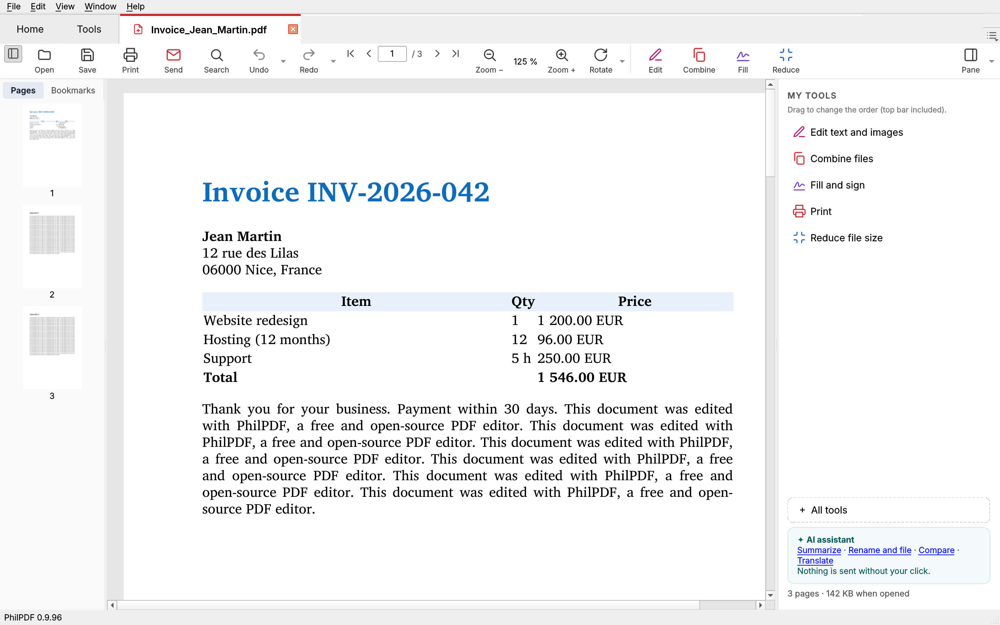
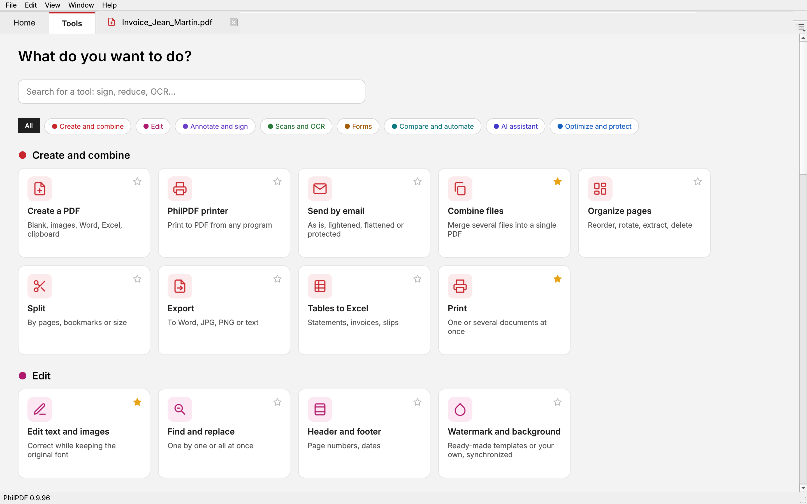

# PhilPDF

**A free and open-source PDF editor for Windows, Linux and Android — an alternative to Adobe Acrobat.**
Read, edit text with the original font, fill and sign, OCR, compress, convert to Word and Excel, scan, and keep your
files in sync across your devices. No account, no ads, no trackers.

*[Version française plus bas](#en-français)*

## Download

Latest version: **[Releases](https://github.com/PhilouElChapo/PhilPDF/releases/latest)**

| Platform | File |
|---|---|
| Windows 10 / 11 | `PhilPDF_Setup.exe` (no admin rights needed) or `PhilPDF_portable.zip` |
| Linux (Ubuntu, Zorin OS, Fedora, Mint...) | `PhilPDF.flatpak` (double-click, or `flatpak install --user PhilPDF.flatpak`) or `PhilPDF_linux_x86_64.tar.gz` |
| Android | Google Play (closed testing for now) or the `.apk` in the Android releases |

Updates are offered inside the app, never forced. The interface is available in English, French, German, Spanish and
Italian.

## What it does

- **Edit** text and images while keeping the original font, find and replace, headers and footers, watermarks,
  bookmarks.
- **Pages**: organize, rotate, extract, split, combine files, compare two versions.
- **Fill and sign**: forms, handwritten and digital signatures (certificates), reusable stamps.
- **Scan and OCR**: scanner support (TWAIN including 32-bit drivers, WIA, network scanners), text recognition
  (Tesseract), clean-up of scanned pages.
- **Convert**: to Word, Excel (tables from statements and invoices), images and text; Word and Excel to PDF; a
  "PhilPDF printer" to print to PDF from any program.
- **Compress and protect**: reduce file size, passwords, true redaction (text really removed).
- **Your clouds**: Google Drive, OneDrive, Dropbox, Box, pCloud, Infomaniak kDrive, WebDAV, Synology NAS, FTP —
  open and save directly, with a preferred account for sending and reading.
- **Sync between your PCs and phone**: recent files, stamps, signatures and settings follow you.
- **Optional AI assistant** with *your own* Claude or Gemini key: summarize, explain simply, translate, fill a form,
  rename and file, extract data. Nothing is sent without your click, and sensitive data is flagged first.

## Privacy

Your documents stay on your devices. PhilPDF has no server: cloud accounts and AI services are reached directly from
your device, only when you ask. See the [privacy policy](https://philouelchapo.github.io/PhilPDF/confidentialite.html).

## Contributing

- A bug or an idea: open an [issue](https://github.com/PhilouElChapo/PhilPDF/issues).
- A fix or an improvement: open a pull request. Contributions are reviewed by the maintainer; only the version
  published here is distributed through the built-in updater.
- Translations are welcome (files in [`langues/`](langues)).
- Maintained in spare time, without any guaranteed response time.

## License

**GNU AGPL v3** (see [LICENSE](LICENSE)). You may use, study, modify and redistribute PhilPDF; modified versions must
remain free under the same license. PhilPDF comes with no warranty.

Built with PyMuPDF / MuPDF (AGPL, Artifex), Qt / PySide6 (LGPL), Tesseract (Apache 2.0), pyHanko (MIT), pdf2docx
(MIT), OkHttp (Apache 2.0, Android), Nunito font (SIL OFL).

---

## En français

**Éditeur PDF libre et gratuit pour Windows, Linux et Android, une alternative à Adobe Acrobat.** Lire, modifier le
texte avec la police d'origine, remplir et signer, OCR, alléger, convertir vers Word et Excel, numériser, et retrouver
ses fichiers sur tous ses postes. Sans compte, sans publicité, sans pisteur.

- **Télécharger** : [dernière version](https://github.com/PhilouElChapo/PhilPDF/releases/latest) — Windows
  (`PhilPDF_Setup.exe`, installation sans droits administrateur, ou `PhilPDF_portable.zip`), Linux (`PhilPDF.flatpak`
  ou `PhilPDF_linux_x86_64.tar.gz`), Android.
- **Fonctions** : modifier le texte et les images, organiser les pages, remplir et signer (y compris signature
  numérique), tampons, numérisation et OCR, allègement, conversion Word / Excel, imprimante PDF, biffage, filigrane,
  comparaison, envoi par e-mail ; Google Drive, OneDrive, Dropbox, Box, pCloud, kDrive, WebDAV, NAS et FTP en direct ;
  synchronisation entre vos postes ; assistant IA facultatif avec votre propre clef Claude ou Gemini.
- **Vos données restent chez vous** : aucun serveur PhilPDF, rien n'est envoyé sans votre clic.
  [Règles de confidentialité](https://philouelchapo.github.io/PhilPDF/confidentialite.html).
- **Participer** : un problème ou une idée, ouvrez un ticket (*Issues*) ; une correction, proposez-la (*Pull
  request*).
- **Licence** : GNU AGPL v3, sans aucune garantie.
