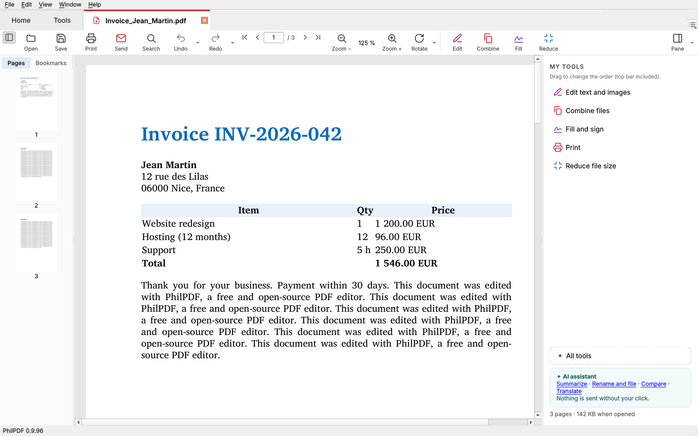
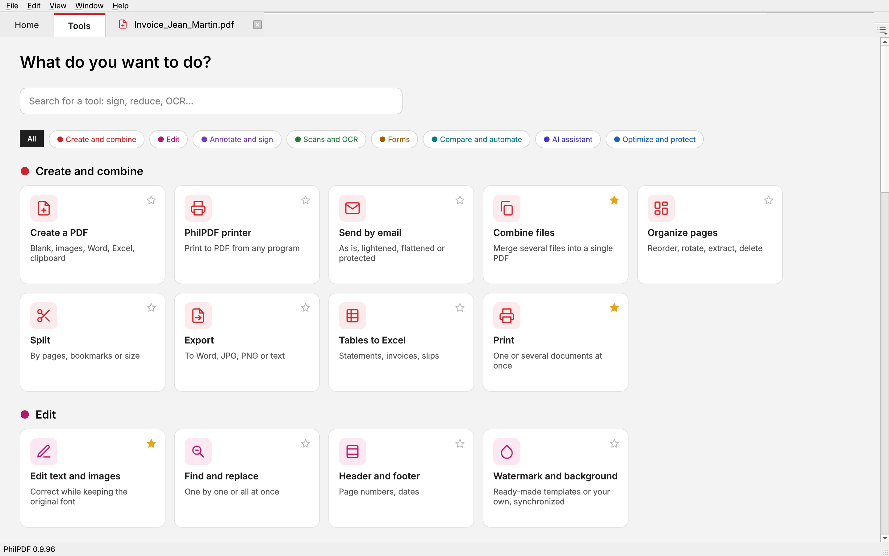

# PhilPDF

**Edit PDF text in its original font, sign, scan and OCR — on Windows, Linux and Android, synced across your devices.**
A free and open-source alternative to Adobe Acrobat, with no subscription: fill forms, compress, convert to Word and
Excel, and find your recent files, stamps and signatures on every device. No account, no ads, no trackers.

*[Version française plus bas](#en-français)*

## Download

Latest version: **[Releases](https://github.com/PhilouElChapo/PhilPDF/releases/latest)**

| Platform | File |
|---|---|
| Windows 10 / 11 | `PhilPDF_Setup.exe` (no admin rights needed) or `PhilPDF_portable.zip` |
| Linux (Ubuntu, Zorin OS, Fedora, Mint...) | `PhilPDF.flatpak` (double-click, or `flatpak install --user PhilPDF.flatpak`) or `PhilPDF_linux_x86_64.tar.gz` |
| Android | **[Google Play](https://play.google.com/store/apps/details?id=io.github.philouelchapo.philpdf)** (recommended, automatic updates), **[F-Droid](https://philouelchapo.github.io/PhilPDF/#fdroid)** (own repository, see below) or the `.apk` in the Android releases |

**F-Droid:** in F-Droid, open *Settings › Repositories › +* and scan the QR code on the
[PhilPDF page](https://philouelchapo.github.io/PhilPDF/#fdroid), or paste `https://philouelchapo.github.io/PhilPDF/fdroid/repo?fingerprint=5ECBFD713BF46AA760A64450F24CA959C7272748377851D00843B314291DB5F7`.
Same APKs as in the releases, signed with the PhilPDF key. This is not the official f-droid.org catalogue.

[Code signing policy](CODE_SIGNING_POLICY.md) (Windows builds are made only by GitHub Actions from this repository).

Updates are offered inside the app, never forced. The interface is available in English, French, German, Spanish and
Italian.

## What it does

- **Edit** text and images while keeping the original font, find and replace, headers and footers, watermarks,
  bookmarks.
- **Pages**: organize, rotate, extract, split, combine files, compare two versions.
- **Fill and sign**: forms, handwritten and digital signatures (certificates), reusable stamps.
- **Scan and OCR**: scanner support (TWAIN including 32-bit drivers, WIA, network scanners), text recognition
  (Tesseract), clean-up of scanned pages.
- **Convert**: to Word, Excel (tables from statements and invoices), images and text; Word and Excel to PDF; a
  "PhilPDF printer" to print to PDF from any program.
- **Compress and protect**: reduce file size, passwords, true redaction (text really removed).
- **Your clouds**: Google Drive, OneDrive, Dropbox, Box, pCloud, Infomaniak kDrive, WebDAV, Synology NAS, FTP —
  open and save directly, with a preferred account for sending and reading.
- **Sync between your PCs and phone**: recent files, stamps, signatures and settings follow you.
- **Optional AI assistant** with *your own* Claude or Gemini key: summarize, explain simply, translate, fill a form,
  rename and file, extract data. Nothing is sent without your click, and sensitive data is flagged first.

## Privacy

Your documents stay on your devices. PhilPDF has no server: cloud accounts and AI services are reached directly from
your device, only when you ask. See the [privacy policy](https://philouelchapo.github.io/PhilPDF/confidentialite.html).

## Contributing

- A bug or an idea: open an [issue](https://github.com/PhilouElChapo/PhilPDF/issues).
- A fix or an improvement: open a pull request. Contributions are reviewed by the maintainer; only the version
  published here is distributed through the built-in updater.
- Translations are welcome (files in [`langues/`](langues)).
- Maintained in spare time, without any guaranteed response time.

## License

**GNU AGPL v3** (see [LICENSE](LICENSE)). You may use, study, modify and redistribute PhilPDF; modified versions must
remain free under the same license. PhilPDF comes with no warranty.

Built with PyMuPDF / MuPDF (AGPL, Artifex), Qt / PySide6 (LGPL), Tesseract (Apache 2.0), pyHanko (MIT), pdf2docx
(MIT), OkHttp (Apache 2.0, Android), Nunito font (SIL OFL).

---

## En français

**Modifiez le texte d'un PDF dans sa police d'origine, signez, numérisez — sur Windows, Linux et Android, synchronisé entre vos appareils.**
Une alternative libre et gratuite à Adobe Acrobat, sans abonnement : remplir les formulaires, OCR, alléger, convertir
vers Word et Excel, et retrouver fichiers récents, tampons et signatures sur tous vos postes. Sans compte, sans
publicité, sans pisteur.

- **Télécharger** : [dernière version](https://github.com/PhilouElChapo/PhilPDF/releases/latest) — Windows
  (`PhilPDF_Setup.exe`, installation sans droits administrateur, ou `PhilPDF_portable.zip`), Linux (`PhilPDF.flatpak`
  ou `PhilPDF_linux_x86_64.tar.gz`), Android sur **[Google Play](https://play.google.com/store/apps/details?id=io.github.philouelchapo.philpdf)** (mises à jour automatiques), sur
  **[F-Droid](https://philouelchapo.github.io/PhilPDF/#fdroid)** (dépôt PhilPDF : dans F-Droid, *Réglages › Dépôts › +*,
  QR code sur la page) ou par le fichier `.apk`. [Code signing policy](CODE_SIGNING_POLICY.md) (politique de signature du code).
- **Fonctions** : modifier le texte et les images, organiser les pages, remplir et signer (y compris signature
  numérique), tampons, numérisation et OCR, allègement, conversion Word / Excel, imprimante PDF, biffage, filigrane,
  comparaison, envoi par e-mail ; Google Drive, OneDrive, Dropbox, Box, pCloud, kDrive, WebDAV, NAS et FTP en direct ;
  synchronisation entre vos postes ; assistant IA facultatif avec votre propre clef Claude ou Gemini.
- **Vos données restent chez vous** : aucun serveur PhilPDF, rien n'est envoyé sans votre clic.
  [Règles de confidentialité](https://philouelchapo.github.io/PhilPDF/confidentialite.html).
- **Participer** : un problème ou une idée, ouvrez un ticket (*Issues*) ; une correction, proposez-la (*Pull
  request*).
- **Licence** : GNU AGPL v3, sans aucune garantie.
